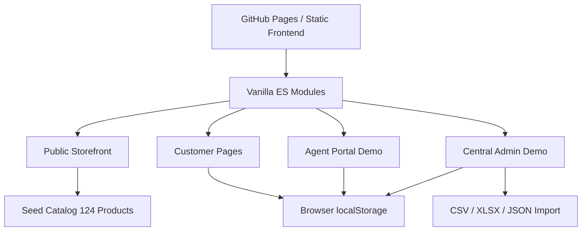
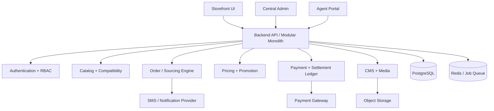

# Endura Battery — نقشه معماری

## دامنه‌ها و صفحات

### فروشگاه عمومی
`/#/`, `/#/shop`, `/#/category/light`, `/#/category/heavy`, `/#/category/ups`, `/#/category/solar`, `/#/product/:id`, `/#/brands`, `/#/brand/:name`, `/#/finder`, `/#/compare`, `/#/cart`, `/#/checkout`, `/#/order-success/:id`, `/#/tracking/:id`

### حساب مشتری
`/#/account/{dashboard,orders,assets,warranties,addresses,payments,support,profile}`

### عامل
`/#/agent/{dashboard,orders,jobs,inventory,coverage,finance,performance,settings}`

### ادمین
`/#/admin/{dashboard,orders,products,agents,inventory,coverage,pricing,finance,tickets,content,imports,settings,logs}`

### محتوای عمومی
`/#/magazine`, `/#/article/:slug`, `/#/services`, `/#/warranty`, `/#/returns`, `/#/faq`, `/#/wholesale`, `/#/become-agent`, `/#/about`, `/#/contact`, `/#/privacy`, `/#/terms`

## معماری فعلی دمو

- چارچوب فرانت‌اند: HTML5 + CSS3 + JavaScript ES Modules؛ **بدون وابستگی به npm و بدون build**.
- روتینگ: Hash Routing (سازگار با GitHub Pages).
- داده اولیه: کاتالوگ واقعی ارسالی کاربر، محتوا و اطلاعات نمونه.
- داده‌های قابل ویرایش: `localStorage` مرورگر، فقط روی همان دستگاه.
- ارتباطات بانکی، SMS، انبار و سرویس‌های امنیتی: در این نسخه پیاده نشده‌اند.

## معماری پیشنهادی نسخه تجاری

برای آغاز نسخه تجاری، معماری **Modular Monolith** نسبت به میکروسرویس زودهنگام مناسب‌تر است: منطق سفارش، موجودی و پرداخت به تراکنش‌ها و هماهنگی دقیق نیاز دارد. استفاده از صف برای اعلان‌ها و وظایف پس‌زمینه توصیه می‌شود.

## مدل داده پیشنهادی تولیدی

`products`, `product_variants`, `brands`, `categories`, `vehicle_compatibilities`, `customers`, `customer_assets`, `customer_addresses`, `agents`, `agent_users`, `service_zones`, `agent_capabilities`, `agent_inventory`, `inventory_reservations`, `orders`, `order_items`, `fulfillments`, `payments`, `refunds`, `agent_settlements`, `settlement_lines`, `warranty_records`, `support_tickets`, `cms_pages`, `cms_posts`, `media_assets`, `audit_logs`.

جداکردن وضعیت‌های `order_status`, `payment_status`, `sourcing_status` و `settlement_status` ضروری است.

## APIهای پیشنهادی تجاری

- `GET /api/catalog/products`, `GET /api/catalog/products/:id`, `GET /api/categories`
- `GET /api/compatibility/vehicles`, `GET /api/compatibility/vehicles/:id/batteries`
- `POST /api/coverage/check`
- `POST /api/checkout/quote`, `POST /api/orders`
- `POST /api/payments/initiate`, `POST /api/payments/verify`, `POST /api/payments/refunds`
- `GET /api/me/orders`, `GET /api/orders/:id`
- `POST /api/oms/orders/:id/assign`, `POST /api/agent/orders/:id/accept`, `POST /api/agent/orders/:id/reject`
- `POST /api/agent/orders/:id/fulfill`, `POST /api/agent/orders/:id/payment-report`
- `POST /api/admin/payments/:id/reconcile`, `POST /api/admin/settlements`
- `GET/POST/PATCH/DELETE /api/admin/products`, `GET/POST/PATCH/DELETE /api/admin/content`

همه APIها نیازمند مجوز سمت سرور، اعتبارسنجی، محدودسازی نرخ، لاگ و تست هستند.

## نکات حیاتی فنی

- قیمت و مبلغ نهایی صرفاً سمت سرور معتبر هستند و هرگز از input مرورگر پذیرفته نمی‌شوند.
- موجودی و ظرفیت نصب باید اتمیک رزرو شوند؛ یک کالا نباید دوبار فروخته شود.
- تایید پرداخت فقط از API درگاه و با کلید idempotency پذیرفته شود.
- مشخصات حقوقی فروشنده در فاکتور و قرارداد عامل شفاف گردد.
- عامل فقط سفارش خود را بعد از پذیرش و تنها به حد موردنیاز مشاهده کند.
- باتری فرسوده معامله/رکورد حسابداری مستقل باشد.
- بارگذاری تصاویر از نوع و اندازه معتبر با ضدبدافزار و ذخیره‌سازی امن محافظت شود.
- برای محصولات و دسته‌بندی‌ها URL پایدار و سئوپذیر در نسخه سروررندر پیشنهاد می‌شود.
