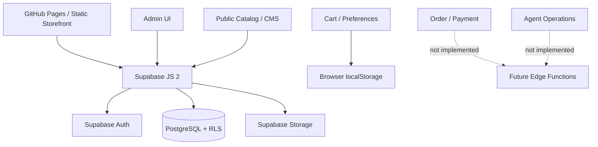

# معماری نسخه V2.0 — Endura Battery + Supabase

## ساختار استقرار

## مسیرهای فرانت‌اند

خانه `/#/`، فروشگاه `/#/shop`، دسته `/#/category/:category`، محصول `/#/product/:id`، برندها `/#/brands`، مقالات `/#/magazine` و `/#/article/:slug`، سبد و تسویه `/#/cart` و `/#/checkout`، مدیریت `/#/admin`.

## اتصال آنلاین فعال

| داده | جدول/منبع | دسترسی |
| --- | --- | --- |
| محصول و قیمت | `products` | مشاهده محصول active برای عموم؛ مدیریت admin |
| بنر، متن فوتر و تنظیمات | `site_settings` (`key='public'`) | خواندن عمومی و نوشتن admin |
| مقاله | `cms_articles` | published عمومی؛ مدیریت admin |
| مناطق خدمات | `service_zones` | active عمومی؛ مدیریت admin |
| عاملان اولیه | `agents` | مدیریت admin |
| حساب مدیر | `auth.users` و `user_roles` | ورود ایمیل/رمز + RLS |
| فایل‌های عمومی | Storage `endura-public` | بازدید عمومی؛ آپلود admin |

## محدودیت‌های این نسخه

ثبت سفارش واقعی و پرداخت در مرورگر **غیرفعال** است. برای فعال‌سازی، Edge Function یا بک‌اند باید قیمت سمت سرور، موجودی منطقه/عامل، رزرو اتمیک، احراز هویت مشتری، درگاه، صحت امضا/وب‌هوک و رسیدگی به عدم تأمین/استرداد را مدیریت کند. پنل عاملان نیز قبل از طراحی مجوزهای RLS اختصاصی و RPCهای امن باز نخواهد شد.

## امنیت

Publishable Key در فرانت‌اند مجاز است؛ اجرای RLS و Grants شرط امنیتی لازم است. هیچ دسترسی مدیریتی صرفاً با `/#/admin` یا تغییر کد فرانت‌اند اعطا نمی‌شود. تنها احراز هویت Supabase و نقش `admin` امکان write می‌دهد. کلید Service Role نباید داخل فرانت‌اند قرار بگیرد.
